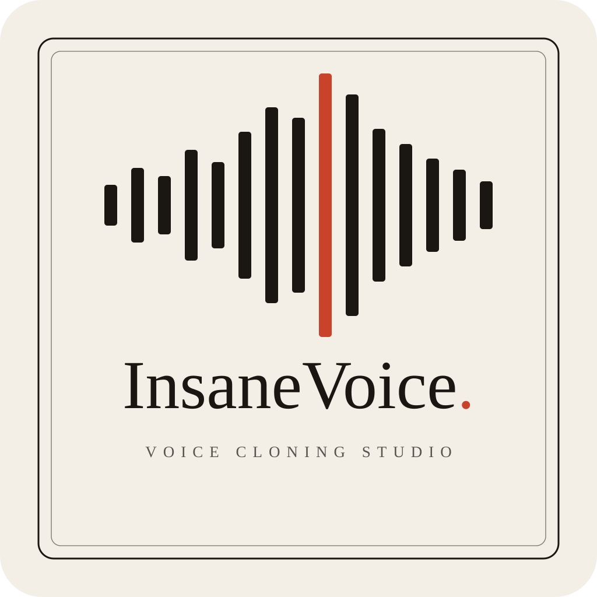

<div align="center">



# InsaneVoice

**A free, local, voice-cloning studio for faceless creators.**

Give it 10–30 seconds of your voice — get a clone that reads any script you type.
No cloud. No account. No API keys. No cost.

`Python 3.10+` · `CPU-friendly` · `Windows / macOS / Linux` · `MIT License`

</div>

---

## What it does

| | |
|---|---|
| 🎙 **Voice DNA** | Upload or record a sample — InsaneVoice measures its pitch, warmth, brightness and grit, draws a fingerprint radar and names the voice type. |
| 🗣 **Cloning** | OpenVoice V2 tone conversion paints any generated speech with *your* voice's colour. Clone strength is a slider, not a black box. |
| ✎ **Studio** | Type any script — sentences are split automatically; speed and base accent (American/British) are yours to pick. |
| ≡ **Batch Studio** | One line per clip. Render a whole video's audio queue in order and download every file. |
| ↺ **History** | Every generation stays on your machine until you delete it. |

Everything is engineered to run on a **plain laptop CPU** — no GPU required.
Expect roughly 3–4× real-time generation (a 10-second clip takes ~30–40s).
That is the price of *free and private*; a GPU makes it real-time.

## Quick start (Windows)

```bat
git clone https://github.com/<you>/InsaneVoice.git
cd InsaneVoice
scripts\setup_windows.bat     :: venv + deps + models (~10 min, one time)
scripts\start_windows.bat     :: http://127.0.0.1:8177 opens itself
```

<details>
<summary>macOS / Linux</summary>

```bash
git clone https://github.com/<you>/InsaneVoice.git
cd InsaneVoice
python3 -m venv .venv && source .venv/bin/activate
pip install torch --index-url https://download.pytorch.org/whl/cpu
pip install -r requirements.txt
git clone --depth 1 https://github.com/myshell-ai/OpenVoice.git third_party/OpenVoice
git clone --depth 1 https://github.com/myshell-ai/MeloTTS.git third_party/MeloTTS
python scripts/patch_melotts.py
python scripts/download_models.py
cd backend && uvicorn main:app --host 127.0.0.1 --port 8177
```

</details>

**You need:** Python 3.10+ and [ffmpeg](https://ffmpeg.org) on your PATH.
The first launch downloads ~330 MB of model checkpoints from HuggingFace.

## How it works

```
 your 10–30s sample ──► Voice DNA (numpy/scipy DSP: F0, formants, spectra)
        │
        └──► OpenVoice SE extractor ──► speaker embedding (.pth)

 any text ──► MeloTTS (EN base speaker, CPU) ──► neutral speech
                      │
                      ▼
        OpenVoice V2 ToneColorConverter
        (transfers YOUR tone onto the speech)
                      │
                      ▼
              your voice, your script ──► wav (watermarked)
```

- **[MeloTTS](https://github.com/myshell-ai/MeloTTS)** (MIT) generates the base speech.
- **[OpenVoice V2](https://github.com/myshell-ai/OpenVoice)** (MIT) performs tone-colour conversion
  and embeds an inaudible watermark.
- **Voice DNA** is InsaneVoice's own numpy/scipy analyser — no heavyweight
  audio stack, just honest DSP: autocorrelation pitch tracking, LPC formants,
  spectral moments.

## Consent & ethics

Cloning a voice without permission is not a feature — it's a crime in many
places. InsaneVoice therefore:

1. **requires a consent confirmation** before any voice is saved,
2. records the consent with the voice profile,
3. **watermarks every generated clip** inaudibly (OpenVoice wavmark),
4. keeps everything **on your disk** — there is no cloud to leak from.

Use it for your own channels, your own characters, your own projects.

## Project layout

```
InsaneVoice/
├── backend/          FastAPI app + Voice DNA + engine wrapper
│   ├── main.py       API surface (upload/record/voices/generate/history)
│   ├── engine.py     MeloTTS + OpenVoice pipeline (lazy-loaded, thread-safe)
│   ├── dna.py        Voice DNA analyser (pure numpy/scipy)
│   └── storage.py    JSON voice profiles & history
├── frontend/         Vanilla-JS studio (no build step, no framework)
├── third_party/      OpenVoice + MeloTTS (cloned at setup)
├── scripts/          setup, download, patch, e2e test
└── branding/         logo source (SVG, regenerable)
```

## Troubleshooting

| Symptom | Fix |
|---|---|
| "Models are not downloaded" | `python scripts/download_models.py` |
| Import fails on m4a / webm | Install ffmpeg, restart the server |
| First generation slow | Engine warms up once per launch — later runs are faster |
| Clone sounds distant | Raise *clone strength*, use a longer/cleaner sample |
| Clone sounds rough | Lower clone strength toward 0.2 |
| Port 8177 busy | `uvicorn main:app --port 8178` from `backend/` |

## Credits

Built with [OpenVoice](https://github.com/myshell-ai/OpenVoice) and
[MeloTTS](https://github.com/myshell-ai/MeloTTS) by MyShell.ai — both MIT.
InsaneVoice is an independent studio wrapper with original Voice DNA
analysis, UI and tooling.

## License

MIT — see [LICENSE](LICENSE).

<div align="center">
<sub>Made for creators who'd rather own their tools.</sub>
</div>
